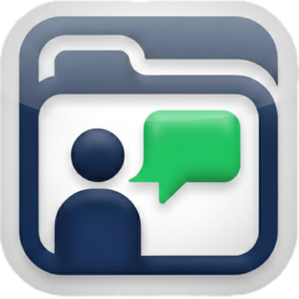
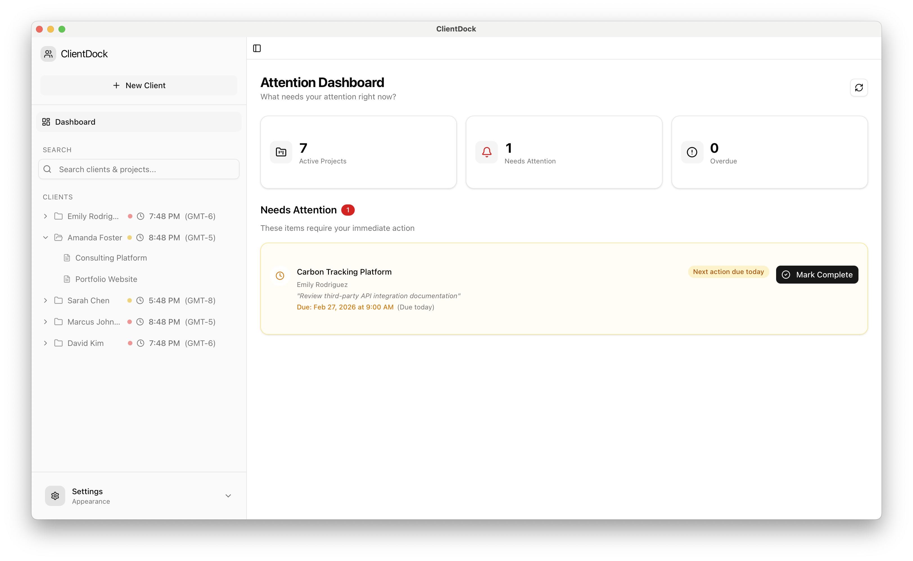
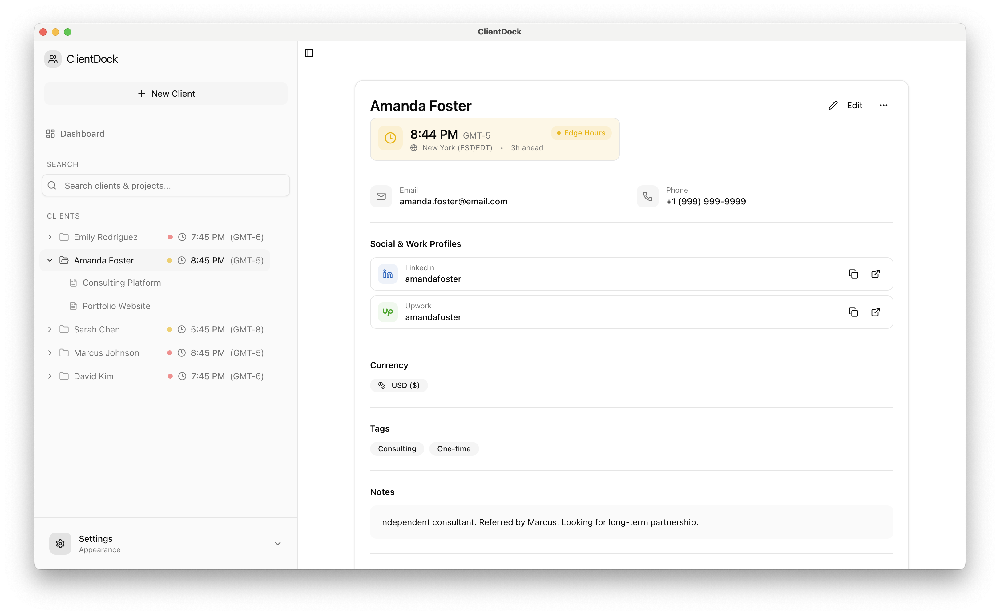
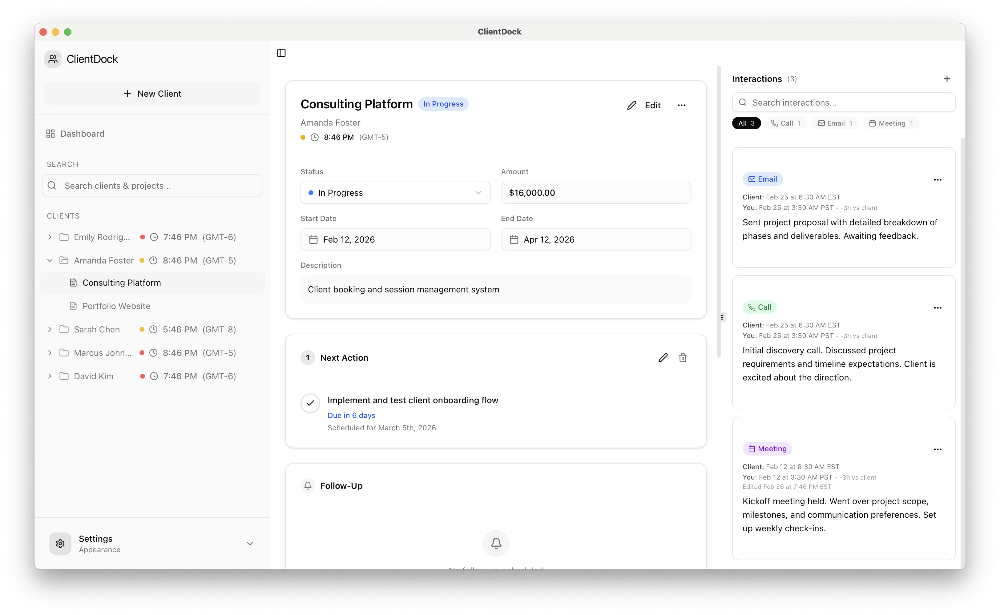
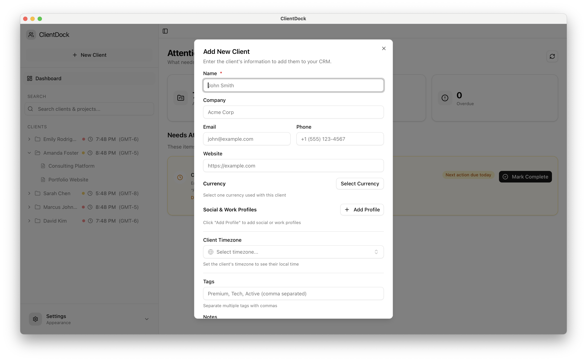
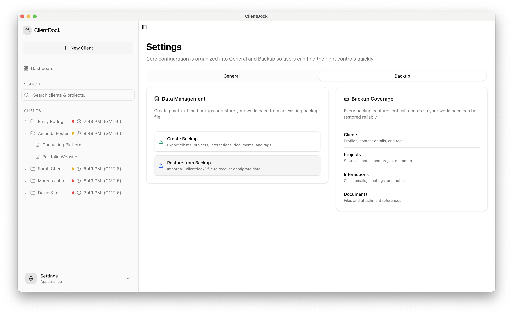

<p align="center">
  
</p>
<h1 align="center">ClientDock</h1>
<p align="center">
  <strong>The CRM that lives on your machine — not someone else's server</strong>
</p>
<p align="center">
  <a href="../../releases/latest"></a>
  
  
</p>

---

## Overview

ClientDock is a privacy-focused desktop CRM that helps you manage your clients, projects, and interactions. All your data stays on your device, giving you complete control and privacy.

> **📢 Beta Notice:** ClientDock is currently in beta. Features and functionality are actively being refined based on user feedback.

---

## Quick Start

### Download & Install

| Platform | Download |
|----------|----------|
| **Windows** | [Get Windows installer (.exe)](https://github.com/CraftIndie/clientdock-releases/raw/master/releases/ClientDock_beta_windows_x64_setup.exe) |
| **macOS** | [Get macOS installer (.dmg)](https://github.com/CraftIndie/clientdock-releases/raw/master/releases/ClientDock_beta_macos_universal.dmg) |
| **Linux** | [AppImage (.AppImage)](https://github.com/CraftIndie/clientdock-releases/raw/master/releases/ClientDock_beta_aarch64.AppImage) / [Deb (.deb)](https://github.com/CraftIndie/clientdock-releases/raw/master/releases/ClientDock_beta_arm64.deb) |

<details>
<summary><strong>Installation Instructions</strong></summary>

**Windows:**
1. Run the downloaded `.exe` installer
2. Follow the installation wizard
3. Launch ClientDock from the Start menu

**macOS:**
1. Open the `.dmg` file
2. Drag ClientDock to your Applications folder
3. Launch the app (if blocked by security, go to System Settings → Privacy & Security → Open Anyway)

**Linux:**

*AppImage:*
```bash
chmod +x ClientDock_beta_aarch64.AppImage
./ClientDock_beta_aarch64.AppImage
```

*Debian/Ubuntu:*
```bash
sudo dpkg -i ClientDock_beta_arm64.deb
```

</details>

---

## Features at a Glance

- **Client Management** — Full client profiles with contact info, social links, tags, notes, and working hours
- **Project Tracking** — Organize projects per client with status, timeline, budget, and auto-saving notes
- **Interaction Logging** — Log calls, emails, meetings, and notes with full timezone support
- **Document Management** — Attach files directly to projects, open or download in one click
- **Next Actions** — Pin one clear next step per project so nothing slips
- **Follow-Up Reminders** — Schedule follow-ups and get surfaced when the time comes
- **Attention Dashboard** — See what's gone quiet, what's overdue, and what needs you today
- **Tags & Search** — Tag clients your way and search across clients and projects instantly
- **Client Timezone Clock** — See your client's local time before you hit send
- **Backup & Restore** — Export and restore your entire database whenever you want

---

## What's Inside

### Know Your Clients, Actually Know Them

**Client Management** is where everything starts. Each client gets a full profile — contact details, social profiles (clickable), notes, tags, and working hours. It's the kind of context that usually lives in a sticky note or buried in your inbox. Now it has a home.

Every client you delete cascades cleanly — their projects, interactions, and documents all go with them. No orphaned data, no surprises.

---

### Projects That Tell You Where Things Stand

**Project Management** keeps your work organized under the right client. Each project has a name, status, timeline, budget, and a notes field that auto-saves as you type — no "Save" button to forget.

Status goes from *Not Started* → *In Progress* → *On Hold* → *Completed* → *Cancelled*, and it's color-coded so you can see what's moving and what's stalled at a glance.

---

### A Log of Every Conversation

Ever jumped on a call with a client and gone completely blank on what you last discussed? **Interaction Logging** fixes that.

Log calls, emails, meetings, and notes. Each entry stores the date, time, timezone, and your notes. Interactions show up newest-first so the most recent context is always at the top. If you edit an entry after the fact, it's marked as edited — nothing is silently changed.

Timezone support is built in and defaults to your local timezone, which matters more than you'd think when your clients are spread across the world.

---

### Your Files, Right Where You Need Them

**Document Management** lets you attach files directly to a project. Contracts, briefs, assets — upload them once and open or download them from inside the app whenever you need them. No digging through folder structures or shared drives.

---

### Always Know What's Next

This is where ClientDock starts feeling less like a database and more like a thinking partner.

**Next Actions** let you pin one clear next step to each project. Not a list of 30 things — just the one thing that moves it forward. It's a small constraint that makes a big difference.

**Follow-Up Reminders** make sure clients don't fall through the cracks. Schedule a follow-up, and ClientDock will surface it when the time comes.

**The Attention Dashboard** pulls it all together. It shows you which clients and projects haven't had any activity in a while, which follow-ups are overdue, and what needs your attention today — without you having to hunt for it.

---

### Tags and Search

**Tags** let you group and filter clients any way you want — by industry, status, priority, whatever makes sense for how you work. And when you need to find something fast, **search** covers your clients and projects so you can pull up what you need without scrolling through everything.

---

### Know What Time It Is for Your Client

Small thing, big impact. The **Client Timezone Clock** shows you the current local time for each client based on their timezone. Before you send that message at 11 PM their time, you'll know.

---

### Backup & Restore

Your data is valuable. **Backup and Restore** lets you export a snapshot of your entire database and restore it later — useful before a system migration, or just as a regular habit. Your data, your responsibility, your control.

---

## Under the Hood

ClientDock is built with Rust (via Tauri) on the backend and React on the frontend. The database is SQLite — a single file on your machine. There are no network requests, no telemetry, and no analytics. The app works completely offline because there's nothing to connect to.

---

## Screenshots

A quick tour of ClientDock in action:

<p align="center">
  
</p>
<p align="center">
  
</p>
<p align="center">
  
</p>
<p align="center">
  
</p>
<p align="center">
  
</p>
<p align="center">
  
</p>

---

## Getting Help

- **Bug Reports:** [Open an issue](../../issues)
- **Feature Requests:** [Share your ideas](../../issues/new)
- **Questions:** Check existing [issues](../../issues) or open a new one

---

## License

This repository contains official beta builds. The source code is proprietary.

**© 2026 ClientDock. All rights reserved.**